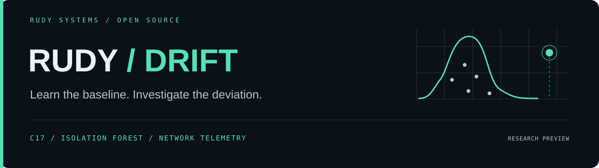

<p align="center"></p>

<p align="center">
  <a href="https://github.com/r4venrudy/rudy-drift/actions/workflows/ci.yml"></a>
  
  <a href="LICENSE"></a>
  
</p>

**Learn normal network behavior. Rank unusual observations. Keep the evidence.**

Rudy Drift is a native C library and command-line tool for network anomaly triage. Train an Isolation Forest on trusted normal observations, calibrate its scores on a separate normal sample, and investigate connections that differ from that baseline. Read Zeek `conn.log` files or your own numeric CSV, inspect feature sensitivity, measure distribution drift, and send review leads into [Rudy Evidence](https://github.com/r4venrudy/rudy-evidence).

**v0.1.0 research preview.** An unusual connection is a lead for an analyst. The score is not a malware probability; this tool does not discover or prove software vulnerabilities. Detection quality depends on representative, clean training and calibration data.

---

### What ships

| Capability | Implementation |
| --- | --- |
| Native learning engine | Isolation Forest in C17; seeded sampling without replacement, bounded tree depth, portable static library |
| Calibrated alerting | Held-out empirical upper-tail p-values; tie-aware thresholds and resolution warning |
| Reviewable explanations | Replace each feature with its training median and measure the score change |
| Baseline drift | Per-feature two-sample Kolmogorov–Smirnov distance, with ties handled explicitly |
| Zeek integration | Field-name-based TSV importer, 14 documented numeric features, explicit missing-value count |
| Evidence handoff | Native Rudy Evidence findings, information severity, observation identifiers and measured values |
| Model persistence | Versioned binary format, schema checks, finite-value checks, bounded tree validation and CRC32 |
| Reproducible evaluation | Synthetic stress test and opt-in deduplicated KDD99 benchmark against a calibrated median/MAD baseline |

The production executable uses the C standard library and platform math library. Python is used only for integration tests and benchmark preparation. There are no runtime cloud services, telemetry uploads, background agents, or automatic retraining.

### Try it

Build with a C17 compiler, CMake 3.20+, and Python 3.9+ for tests:

```sh
cmake -S . -B build -DCMAKE_BUILD_TYPE=Release
cmake --build build --config Release
ctest --test-dir build -C Release --output-on-failure
```

On Linux/macOS or a single-configuration build:

```sh
build/rudy-drift fit examples/train.csv examples/calibration.csv baseline.rdm
build/rudy-drift score baseline.rdm examples/observations.csv --alpha 0.05
build/rudy-drift drift baseline.rdm examples/observations.csv
build/rudy-drift evidence baseline.rdm examples/observations.csv > findings.json
```

On Windows with Visual Studio, use `build\Release\rudy-drift.exe`. The release ZIP contains `bin/rudy-drift.exe`; Linux/macOS ZIPs contain `bin/rudy-drift`. Example inputs are **synthetic** and demonstrate the workflow, not a deployable network baseline. Fit creates a new model file and refuses to overwrite existing paths.

For actual Zeek telemetry:

```sh
rudy-drift zeek trusted-training-conn.log > train.csv
rudy-drift zeek separate-normal-conn.log > calibration.csv
rudy-drift zeek review-conn.log > observations.csv
rudy-drift fit train.csv calibration.csv network.rdm
rudy-drift score network.rdm observations.csv
```

Choose separate trusted normal periods for training and calibration, and evaluate on a third period. Do not train on the traffic you are trying to investigate. Batch inputs are validated before scoring output begins. See [usage and data contracts](docs/usage.md) for limits, exit codes, platform redirection notes, and the Zeek feature definitions.

### GitHub package

The [GitHub container package](https://github.com/users/r4venrudy/packages/container/package/rudy-drift) includes the Linux amd64 CLI, C library, headers and synthetic examples. Docker runs it as an unprivileged user. The publication workflow builds the source, runs the native and CLI tests, then exercises the installed image with its network disabled and root filesystem read-only before pushing it.

```sh
docker pull ghcr.io/r4venrudy/rudy-drift:latest
docker run --rm --network none --read-only ghcr.io/r4venrudy/rudy-drift:latest --version

# Run the included synthetic example; the model is discarded on exit.
docker run --rm --network none --read-only \
  --tmpfs /data:rw,uid=10001,gid=10001,mode=0700 \
  --entrypoint /bin/sh ghcr.io/r4venrudy/rudy-drift:latest -ec '
    examples=/usr/local/share/rudy-drift/examples
    rudy-drift fit "$examples/train.csv" "$examples/calibration.csv" /data/model.rdm
    rudy-drift score /data/model.rdm "$examples/observations.csv"
  '
```

For your own files, bind-mount input directories read-only and a separate model/output directory writable by UID 10001. Models are not saved back to the host unless you provide that mount. Images are tagged `latest` and `sha-<full-commit>`; pin the published digest for an exact image. This container runs the offline CLI; it does not collect live traffic. Windows users can use Docker's Linux-container mode or the native release ZIP.

### One observation, explained

```json
{"id":"review-001","score":0.72,"p_value":0.008,"alpha":0.05,"alert":true,
 "sensitivity":[{"feature":"log_orig_bytes","value":18.2,
 "training_median":6.9,"score_delta":0.11}]}
```

Illustrative values. Positive `score_delta` means replacing that measurement with the training median lowered the anomaly score. Sensitivities are not additive, causal, or proof of an attack. Correlated features can make a median replacement unrealistic. Non-alerts return an empty sensitivity array to avoid unnecessary work.

### Evidence that travels

```sh
rudy-drift evidence network.rdm observations.csv > findings.json
rudy-evidence normalize native engagement-001 findings.json > bundle.json
```

Exported findings use rule `DRIFT.ANOMALY.001`, severity `info`, and the observation ID as an `other` asset. Keep IDs unique within an evidence scope to avoid merging distinct observations. No CVE, CWE, exploitability, or maliciousness is inferred.

### Measured, with limits

The included benchmark compares this implementation to maximum median/MAD deviation using the same calibration rows and alert threshold. [Full results and methodology](docs/benchmarks.md) include false positives and per-family misses. KDD99 is a historical dataset with a heavily skewed attack mix; a strong aggregate result does not establish modern operational accuracy.

### Embed it

```cmake
find_package(RudyDrift CONFIG REQUIRED)
target_link_libraries(your_tool PRIVATE RudyDrift::rudy_drift)
```

Install with `cmake --install build --config Release --prefix install`. The [public C API](include/rudy_drift.h) supports fitting, scoring, sensitivity, drift, and model persistence. An [installed-package consumer](examples/consumer) demonstrates loading and scoring a model. C++ consumers can include the same header.

### Design and boundaries

[Architecture](docs/architecture.md) · [Model format](docs/model-format.md) · [Usage](docs/usage.md) · [Benchmarks](docs/benchmarks.md) · [Security](SECURITY.md) · [Contributing](CONTRIBUTING.md)

The first release is an offline batch tool. It does not inspect payloads, run exploits, block connections, or replace an IDS. Classic Isolation Forest has blind spots: it cannot split a feature that is constant in training, and its scores saturate beyond observed ranges. Distribution drift is a separate report; it never silently changes the trained model or its calibration.

---

<p align="center"><strong>RUDY SYSTEMS</strong><br>Systems tools with inspectable results.<br><a href="https://rudy.systems">rudy.systems</a> · <a href="https://github.com/r4venrudy">Selected work</a></p>
